# Apex Rush 2027

A scroll-story landing page for a **fictional** racing event. As you scroll, the camera follows a car around a track built from tiles of the [Kenney Racing Kit](https://kenney.nl/assets/racing-kit) (CC0), with a chapter at each corner.

> **Sample content.** "Apex Rush" is a placeholder. Every name, date, place, team, number and price is invented, and nothing refers to a real series, team, driver, sponsor, circuit or brand. It is labelled as sample content in the source and on the page.

Stack: Vite, strict TypeScript, vanilla three.js, GSAP ScrollTrigger, Lenis, Vitest, Playwright. All dependency versions are pinned exactly.

## Setup

```bash
# 1. Put the Kenney ZIP here (it is git-ignored and never committed):
#    assets-src/kenney_racing-kit.zip
npm ci
npm run optimise:models   # only needed to rebuild public/models from the ZIP
npm run dev
```

Other commands: `npm test` (unit tests), `npm run lint`, `npm run build`, `npm run test:e2e` (Playwright, builds and serves the site itself), `npm run capture` (re-captures `public/stills/*` and `public/og.jpg` from the 3D scene).

Playwright uses the Chromium it finds. Set `CHROMIUM_PATH` to use a specific binary. A Dockerfile builds the site and serves it with nginx (`docker build -t apex-rush . && docker run -p 8080:80 apex-rush`).

## Chapters

| Desktop                                          | Phone                                          |
| ------------------------------------------------ | ---------------------------------------------- |
| 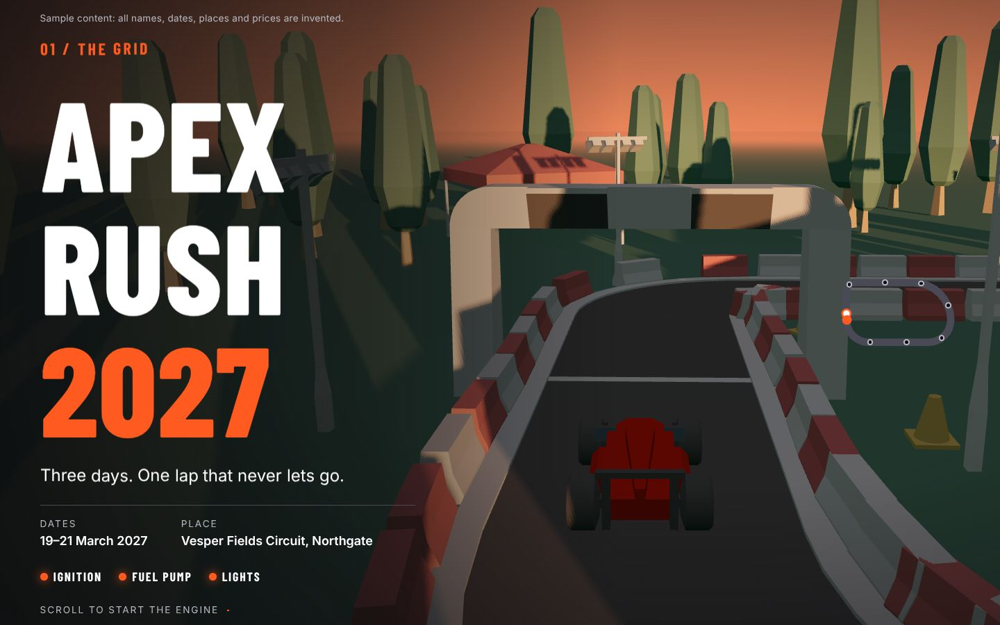         | 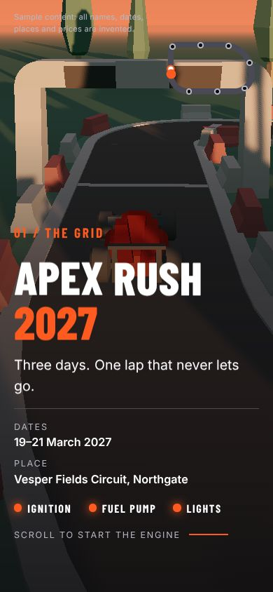         |
| 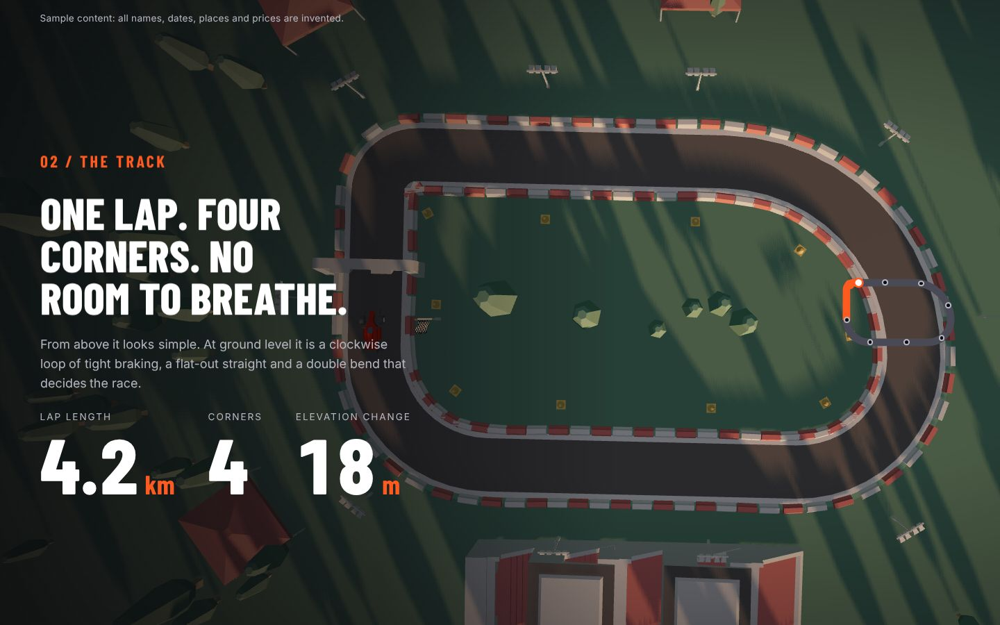       | 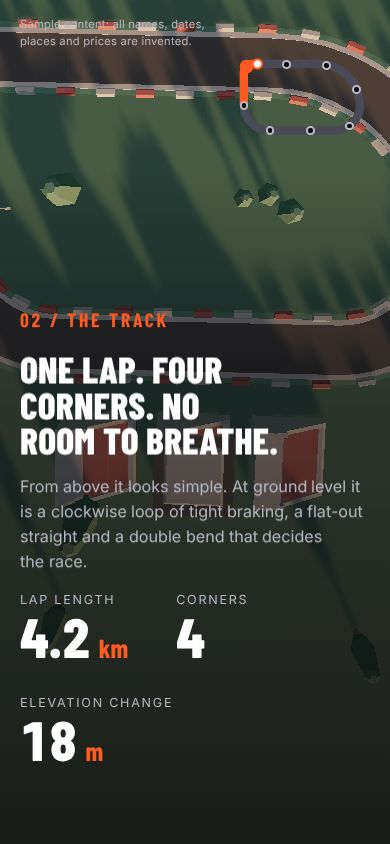       |
| 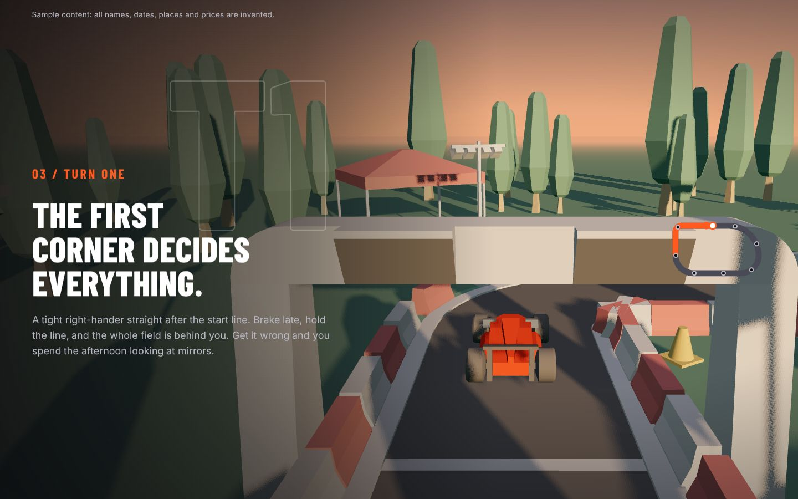  | 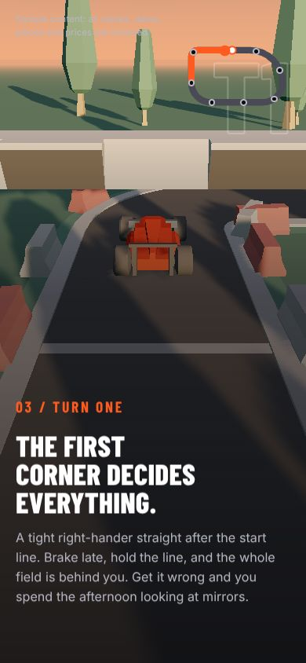  |
| 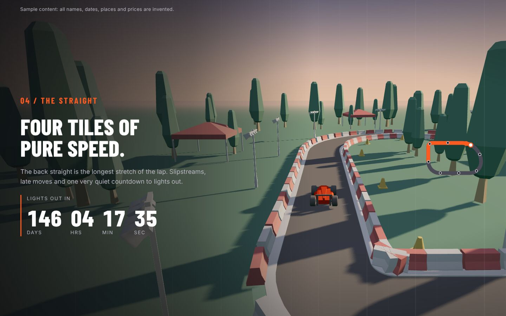 | 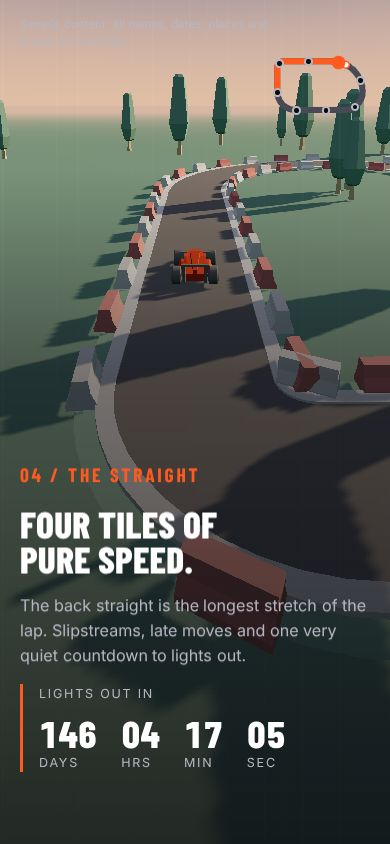 |
| 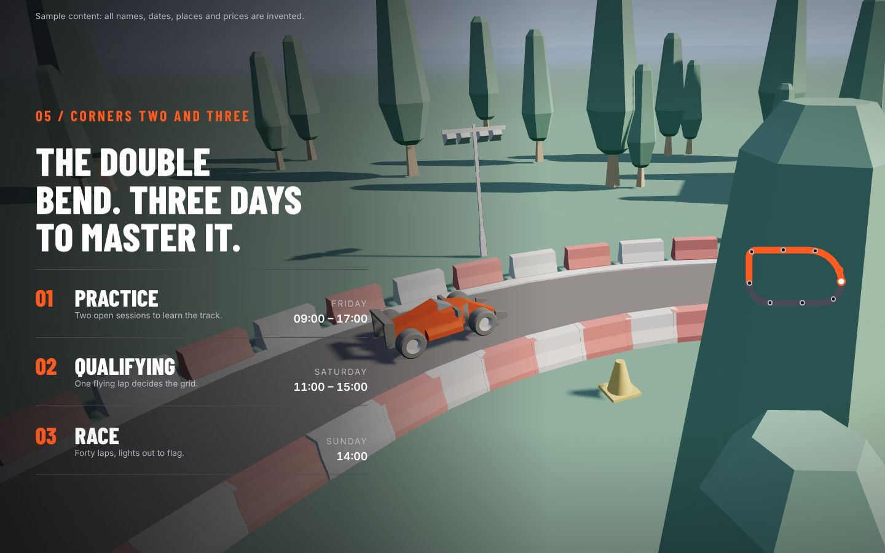 | 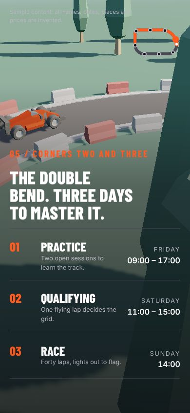 |
| 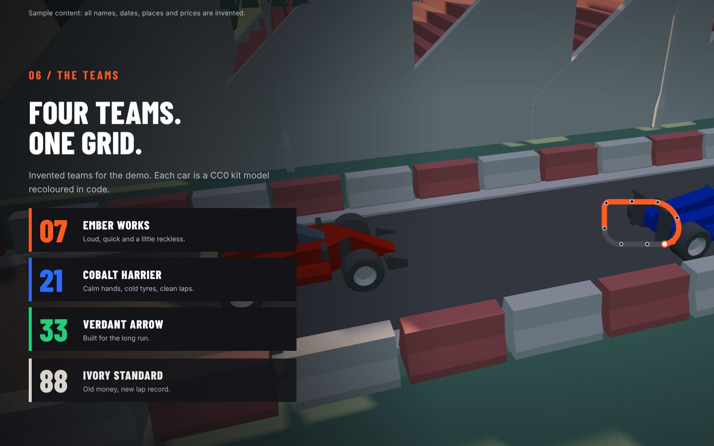       | 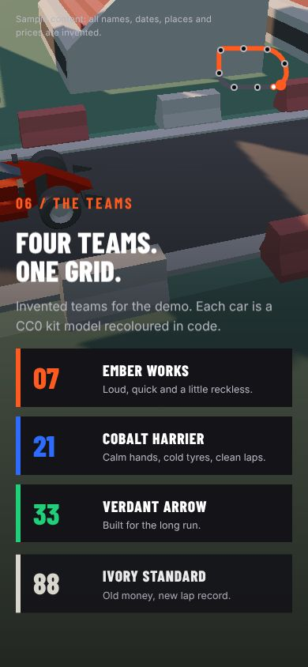       |
| 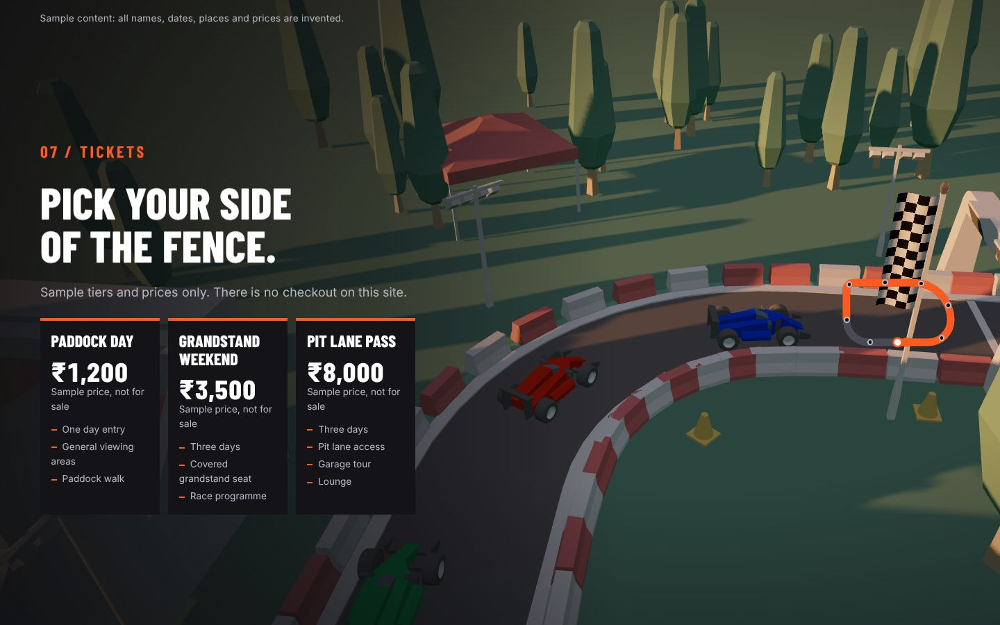   | 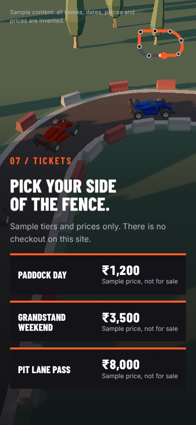   |
| 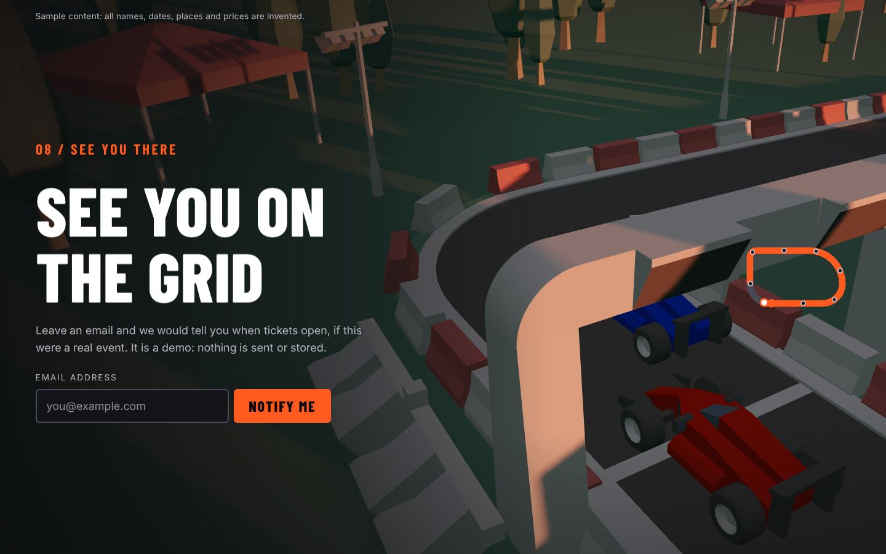     | 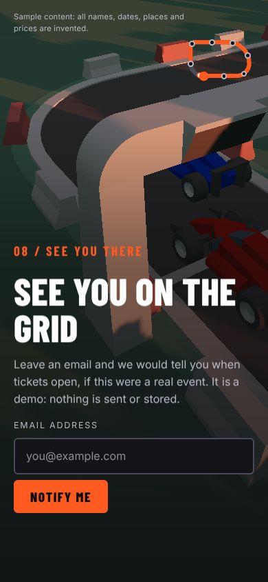     |

## How the track and camera work

- `src/track.ts` lists the tiles (`tile`, `row`, `col`, `rotation`). `validateTrack()` checks that each tile's exit meets the next tile's entry and that the loop closes with no overlaps (unit-tested).
- `src/trackCurve.ts` builds a closed `CatmullRomCurve3` through the tile centrelines.
- `src/cameraPath.ts` is a pure function: **one** scroll progress value (0 to 1) becomes a camera pose, the car's place on the lap, the sky mood and the car formation. Shots are stops on a monotone spline, so the camera never overshoots. Chapter lengths come from the `weight` of each chapter in `src/content.ts`.
- `src/sky.ts` blends dawn, midday, golden hour and dusk. `src/formation.ts` places the convoy and the final grid.
- `src/scene/*` builds the world (instanced tiles, barriers and props), recolours cars in code for team liveries, and draws the frame.

## How the models were optimised

`scripts/optimise-models.mjs` unzips only the pieces the site uses (6 tiles, 4 cars, 11 props) and runs glTF-Transform dedupe, prune, weld, quantize and meshopt compression. The kit has no textures, so there is nothing to compress to WebP or KTX2. `public/models` is about 177 KB against an 8 MB budget. The kit's billboard and pit garage models are left out on purpose because they carry a brand logo.

## Reskin for a client

Copy and edit two files:

1. `src/content.ts`: names, dates, chapter text, colours, teams, ticket tiers.
2. `src/track.ts`: the tile layout. Keep the `TRACK_ANCHORS` indices pointing at the right kind of tile; `npm test` checks that.

Then run `npm test`, `npm run capture` (new stills and OG image) and `npm run build`.

## Performance and accessibility notes

- Pixel ratio is capped at 2 (1 on phones), props and tiles are instanced, shadow maps are 2048 (512 on phones), and rendering pauses when the tab is hidden or the canvas is off screen. The 3D code is a separate lazy chunk, so the text paints first.
- Phones (360 to 430 px, touch, or 2 cores or fewer) get fewer props and simpler shadows. Touch scrolling drives the camera the same way.
- `prefers-reduced-motion` and no-WebGL show a static page with a still image per chapter and simple fades. All information is real text in every mode.
- The canvas is `aria-hidden`. Chapter markers are real links with visible focus, arrow keys, Home and End. `[` and `]` move between chapters.
- Lighthouse in this sandbox (software WebGL, no GPU, preview server without compression): accessibility 100, best practices 100, SEO 100, performance about 66 to 75 on mobile and about 71 on desktop. The score is held down by total blocking time from software rendering. It has not been measured on a real GPU.

## Credits

3D models: Racing Kit by Kenney (kenney.nl), CC0 1.0. See [CREDITS.md](CREDITS.md). Fonts: Barlow Condensed and Inter via `@fontsource` (SIL OFL 1.1).

## Limitations

- No backend: the notify-me form validates the email and shows a success message, and stores and sends nothing. There is no checkout.
- Docker image build was not run here because there is no Docker daemon in this sandbox.
- The Lighthouse performance target of 90 was not reached in the sandbox; see above.
- The car and prop models are low-poly kit models, so close-ups look blocky by design.
